# git-trenes

[English](README.md) · **Español**

Una GitHub Action que dibuja un **tren en pixel art** a partir de tu actividad pública y lo guarda como SVG animado para tu README de perfil. Es la versión con trenes de [git-koi](https://github.com/yalongwastaken/git-koi).



## Qué significa cada cosa

| Tu actividad | En el tren |
| --- | --- |
| Contribuciones del último año | **Vagones**, de 1 a 6 (50 / 200 / 500 / 1000 / 2000) |
| Lenguaje principal | **Franja** con el color oficial del lenguaje en GitHub |
| Racha actual | Letrero LED **"RACHA 12"** y ventanas iluminadas (30 días = todas) |
| Lo que hiciste ayer | **0**: parado con las puertas abiertas · **1-3**: lento · **4-9**: normal · **10+**: veloz, con chispas y líneas de velocidad |
| Esa misma actividad | **Semáforo** junto a la vía: rojo (0), ámbar (poca) o verde (normal o mucha) |

La racha no se rompe a primera hora: si hoy todavía no hay actividad, cuenta desde ayer.

## Uso

Crea `.github/workflows/tren.yml` en tu repositorio de perfil (el que se llama como tu usuario):

```yaml
name: Tren de GitHub
on:
  schedule:
    - cron: "0 6 * * *"
  workflow_dispatch:
permissions:
  contents: write
jobs:
  tren:
    runs-on: ubuntu-latest
    steps:
      - uses: actions/checkout@v5
      - uses: Cracksmity/git-trains@main
      - run: |
          git config user.name "git-trenes"
          git config user.email "git-trenes@users.noreply.github.com"
          git add dist
          git diff --cached --quiet || (git commit -m "chore: actualizar tren" && git push)
```

Y en tu `README.md`, para que cambie con el tema de GitHub:

```html
<picture>
  <source media="(prefers-color-scheme: dark)" srcset="dist/tren-dark.svg">
  
</picture>
```

## Opciones

| Entrada | Por defecto | Qué hace |
| --- | --- | --- |
| `tren` | `auto` | `auto` evoluciona con tus vagones; o fija un modelo (ver abajo); o la ruta a [tu propio tren](#haz-tu-propio-tren-con-ia) en JSON |
| `fondo` | `ciudad` | `ciudad` (aleatoria), `nueva-york`, `osaka` o la ruta a [tu propio skyline](#fondos-de-ciudad) en JSON |
| `modo` | `single` | `single`: un tren con tu lenguaje principal · `multi`: 3 vías, un tren por lenguaje, en sentidos opuestos |
| `tema` | `both` | `both` escribe `tren-light.svg`, `tren-dark.svg` y `tren.svg` (automático); o `light`, `dark`, `auto` |
| `idioma` | `es` | `es` o `en`: cambia la palabra del letrero (`RACHA` / `STREAK`) y los textos de las tarjetas |
| `etiqueta` | según `idioma` | Palabra del letrero LED (si la fijas, manda sobre `idioma`) |
| `escala` | `2` | Tamaño de cada píxel (1 a 6) |
| `usuario` | dueño del repo | Usuario a dibujar |
| `github-token` | `github.token` | Para contar contribuciones privadas usa un PAT |
| `salida` | `dist` | Carpeta de salida |
| `tarjetas` | `none` | Tarjetas de perfil: `stats`, `langs` o `both` (ver abajo) |
| `rango` | `letra` | Centro del anillo de la tarjeta de estadísticas: `letra` (S, A+, B...) o `github` (la marca) |
| `borde` | `true` | Borde de las tarjetas |
| `lenguajes-max` | `6` | Lenguajes en la tarjeta de lenguajes (1 a 10) |
| `color-fondo`, `color-titulo`, `color-icono`, `color-texto`, `color-anillo` | tema oscuro de GitHub | Colores de las tarjetas, hexadecimal sin `#` |

Salidas: `archivos`, `vagones`, `racha`, `estado`, `modelo`.

## Tarjetas de perfil

Con `tarjetas: both` la Action escribe además `tarjeta-stats.svg` y `tarjeta-lenguajes.svg`: una tarjeta de estadísticas (estrellas, commits del último año, PRs, issues y repositorios a los que contribuiste, con un anillo de rango) y otra con tus lenguajes más usados. Siguen el esquema de las tarjetas de [github-readme-stats](https://github.com/anuraghazra/github-readme-stats), pero se **generan dentro de tu workflow**, con código propio: no dependen de ningún servicio externo que pueda caerse, ni de acciones de terceros.

 

```yaml
      - uses: Cracksmity/git-trains@main
        with:
          tarjetas: both
          idioma: en
          rango: github
          borde: "false"
          color-fondo: 0F1115
          color-titulo: C9A04A
          color-icono: 12A5A5
          color-texto: EEE8DC
          color-anillo: C9A04A
```

Si la consulta de las estadísticas falla (por ejemplo, un límite de la API), la Action avisa con un `::warning::` y sigue: el tren se genera igual. El rango es una aproximación (mezcla ponderada de commits, PRs, issues, reseñas, estrellas y seguidores). Para contar contribuciones privadas usa un PAT en `github-token`.



## Modelos

| id | Inspiración | Corriente |
| --- | --- | --- |
| `tranvia` | TEG-90 de SITEUR, Guadalajara: vino con franjas blancas, dos cuerpos articulados sobre un bogie compartido | Catenaria |
| `metro-naranja` | NC-82 del Metro de la CDMX: frente facetado y rodadura neumática | Barra guía |
| `metro-gris` | Frota L del Metrô de São Paulo (como el L43): acero inoxidable acanalado y máscara negra | Tercer riel |
| `metro-amarillo` | A650 renovado de Los Ángeles: frente amarillo con puerta de emergencia al centro | Tercer riel |
| `metro-blanco` | Alstom Metropolis de la línea 3 de Guadalajara: banda de ventanas oscura y cara negra | Catenaria |
| `bala` | Tren de alta velocidad | Catenaria |

Con `tren: auto` el modelo sube con los vagones: tranvía → metro naranja → metro gris → metro amarillo → metro blanco → tren bala. El nombre anterior `suburbano` sigue funcionando como `metro-blanco`.

Todos los trenes tienen cabina en ambos extremos (faros blancos adelante, luces rojas atrás). La catenaria solo aparece sobre los trenes con pantógrafo; los demás corren sobre un tercer riel.

## Haz tu propio tren (con IA)

Cualquier tren se describe como un JSON pequeño: colores, franjas, puertas y la trompa dibujada fila por fila. No hace falta saber programar; lo escribe una IA a partir de una foto o una descripción:

1. Copia [docs/ia/tren.md](docs/ia/tren.md) en el chat de tu IA (Claude, ChatGPT, Gemini...) y, al final, describe tu tren o adjunta una foto.
2. Guarda el JSON que te devuelva en tu repositorio de perfil, por ejemplo en `.github/tren.json`.
3. En el workflow, usa `tren: .github/tren.json`.

```yaml
      - uses: Cracksmity/git-trains@main
        with:
          tren: .github/tren.json
          fondo: nueva-york
```

Si algo no cuadra (un color mal escrito, una fila de más), la Action se detiene y lista **todos** los problemas en el log; pégaselos a la IA y que los corrija. En el playground (`npm run preview`) puedes pegar el JSON y verlo al instante, con los mismos mensajes de error.



Ejemplos: [examples/tren-nueva-york.json](examples/tren-nueva-york.json), inspirado en los R160 del metro de Nueva York, y [examples/tren-osaka.json](examples/tren-osaka.json), en la serie 400 del metro de Osaka. El formato usa las mismas claves que [src/models.js](src/models.js), así que un tren que guste mucho puede pasar al catálogo copiándolo tal cual. El archivo solo se lee como datos: nada de lo que traiga se ejecuta, y cada color y medida se valida antes de dibujar.

## Fondos de ciudad

Detrás del tren va una ciudad. Por defecto es aleatoria, y con `fondo: .github/fondo.json` es la tuya. Vienen dos incluidas:

| `fondo` | Qué se ve |
| --- | --- |
| `nueva-york` | One World Trade Center, Empire State, Chrysler, el puente de Brooklyn y la Estatua de la Libertad |
| `osaka` | Pagoda de Shitennō-ji, la noria, Tsutenkaku, Abeno Harukas, el Umeda Sky Building, un puente atirantado y el castillo |

Un fondo es una lista de edificios en pixel art, **sin demasiado detalle**: cada uno es un bloque con un remate (escalonado, aguja, antena, cúpula, pirámide) o un dibujo fila por fila para monumentos con forma propia. No lleva colores: usa los del tema, así que cambia solo entre claro y oscuro y de noche se prenden las ventanas. Para hacer el tuyo, copia [docs/ia/fondo.md](docs/ia/fondo.md) en tu IA con la ciudad que quieras o una foto. Ejemplo: [examples/fondo-cdmx.json](examples/fondo-cdmx.json).

La foto solo sirve de referencia: lo que se guarda es la silueta, nunca la imagen.



Así salió Osaka a partir de dos fotos (un skyline y un tren de la serie 400 de la línea Chuo), siguiendo esas mismas instrucciones: el fondo es `fondo: osaka` y el tren es [examples/tren-osaka.json](examples/tren-osaka.json).

## Cómo funciona

- Sin dependencias ni compilación: JavaScript puro (Node 24) que corre directo en el runner.
- Cada tren se dibuja **por código sobre una cuadrícula común** (coches de 64 px con 2 o 3 puertas por lado, bogies de dos ruedas de disco de 7 px con bastidor y cajas de grasa, pintados con la paleta de cada modelo), no a partir de imágenes. Las capas (carrocería, puertas, ruedas, letrero, chispas) se animan por separado.
- El resultado es un SVG de ~50 KB (~80 KB en modo `multi`) con CSS: el tren avanza **de 1 px en 1 px** (`steps()`), las marcas del disco de las ruedas alternan dos fotogramas girados 60°, las nubes derivan despacio y en el tema oscuro titilan las estrellas. Respeta `prefers-reduced-motion`.
- La escena trae ciudad, talud con arbustos, catenaria o tercer riel según el tren y, en el modo `multi`, un paisaje distinto detrás de cada vía extra (pueblo, bosque).
- El letrero LED usa una fuente propia de 3×5 píxeles; el tren no usa texto SVG, así que no depende de fuentes. (Las tarjetas sí usan texto, con la fuente del sistema de quien las ve.)

## Desarrollo

```bash
npm run preview    # playground en http://localhost:4173 (controles en vivo)
npm run muestra    # genera SVG con datos de ejemplo en ./muestra
npm test           # pruebas
node scripts/sheet.js hoja.png 5 3 0   # hoja PNG ampliada de todos los modelos
node scripts/sheet.js mio.png 5 2 0 examples/tren-nueva-york.json   # ...o de un tren en JSON
INPUT_TREN=examples/tren-nueva-york.json INPUT_FONDO=examples/fondo-cdmx.json npm run muestra
node scripts/docs.js                   # regenera los SVG de docs/
```

Para añadir un fondo incluido, agrégalo a `SKYLINES` en [src/skyline.js](src/skyline.js).

Para añadir un modelo, agrega una entrada en [src/models.js](src/models.js) (paleta, franjas, forma de la trompa) y su id en `MODEL_ORDER`.

Las imágenes de `reference/` son solo referencia de color y forma; no se usan en el SVG y los logotipos que aparecen en ellas no se reproducen.

## Licencia

[MIT](LICENSE).
