# git-trains

**English** · [Español](README.es.md)

[](https://github.com/Cracksmity/git-trains/actions/workflows/ci.yml)
[](LICENSE)

Your GitHub activity as a **pixel-art train**: it gets longer with your contributions, wears the color of your top language and runs as fast as you worked yesterday. A GitHub Action writes it as an animated SVG for your profile README, every day, with no external service.

<picture>
  <source media="(prefers-color-scheme: dark)" srcset="https://raw.githubusercontent.com/Cracksmity/git-trains/output/train-dark.svg">
  
</picture>
<picture>
  <source media="(prefers-color-scheme: dark)" srcset="https://raw.githubusercontent.com/Cracksmity/git-trains/output/train-calendar-dark.svg">
  
</picture>

<sub>That's the author's train and [calendar](#calendar-mode) today, redrawn every morning by [this repo's own workflow](.github/workflows/train.yml). Try every option in the **[playground](https://cracksmity.github.io/git-trains/preview/)**.</sub>

## What each part means

| Your activity | On the train |
| --- | --- |
| Contributions in the last year | **Cars**, from 1 to 6 (50 / 200 / 500 / 1000 / 2000) |
| Top language | A **stripe** in that language's official GitHub color |
| Current streak | The LED sign **"STREAK 12"** and the lit windows (30 days lights them all) |
| What you did yesterday | **0**: stopped with its doors open · **1-3**: slow · **4-9**: normal · **10+**: fast, with sparks and speed lines |
| Same activity | A **signal** by the track: red (0), amber (a little) or green (normal or a lot) |
| Your username | The **station sign**, and a procedural **city of your own**: no two users get the same skyline |

Your streak doesn't break first thing in the morning: if there's no activity yet today, it counts from yesterday.

## Unlockable cars

Some milestones add a special car to your train, right behind the cab. Only one is shown, the rarest you've earned.

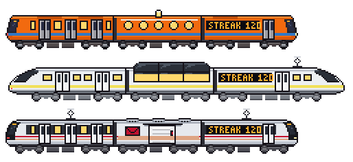

| You earn | Car | What it looks like |
| --- | --- | --- |
| 500+ pull requests | **Mail car** | No windows: a sliding cargo door, an envelope, and a stripe in your top language's color |
| A 100-day streak | **Dining car** | Round windows that glow, and a little lamp on the roof |
| 100+ stars on your repositories | **Observation car** | A raised glass roof and panoramic windows |

The cars are drawn in the palette of whichever train they join, and the image title gets a line saying which one you earned. The streak is your current one, so the dining car leaves if the streak breaks. A special car counts as one more car: on a 6-car train it takes the place of the last regular car so the train still fits the scene.

They need your profile numbers (stars and pull requests), which is one more API request per run. If it fails, the Action logs a `::notice::` and draws the train without it. Set `unlocks: false` to turn them off.

## Calendar mode

Set `calendar: true` to write a contribution calendar alongside the train. A mini version of your train snakes through the weeks, eating contribution cells and growing to the same length as the scene train. It works with custom and steam trains too. Its stripe, windows and speed follow your activity; the caption shows your contributions and streak. `language` and `label` also apply. The calendar follows the selected theme and parks the train when reduced motion is requested.


```yaml
      - uses: Cracksmity/git-trains@v1
        with:
          calendar: true
```

With the default `theme: both`, add this to your README:

```html
<picture>
  <source media="(prefers-color-scheme: dark)" srcset="dist/train-calendar-dark.svg">
  
</picture>
```

The Action also writes `train-calendar.svg`. With a single theme, it writes only that calendar file. See also the [steam example](docs/example-calendar-steam.svg).

## Seasons and holidays

The scene follows the calendar, so your profile feels alive all year. On the day the Action runs (UTC) it adds a few pixels of decoration on their own layers, behind the train, and still stops with reduced motion:

| When | What the scene wears |
| --- | --- |
| Winter (Dec – Feb) | light snow falling, snow on the roofs and on the ground |
| Spring (Mar – May) | a few pink petals drifting |
| Summer (Jun – Aug) | nothing: the plain scene |
| Autumn (Sep – Nov) | orange leaves |
| Oct 1 – 30 · Hacktoberfest | a small pumpkin by the signal |
| Oct 31 – Nov 2 · Día de Muertos | marigold papel picado strung along the line |
| Dec 15 – Jan 6 · Christmas | blinking lights on the wire |
| Dec 31 – Jan 1 · New Year | fireworks behind the city |

| | |
| --- | --- |
| <br><sub>Winter (Jan 20)</sub> | <br><sub>Spring (Apr 10)</sub> |
| <br><sub>Día de Muertos (Nov 1)</sub> | <br><sub>Christmas (Dec 20)</sub> |

A holiday wins over the season, and when two holidays overlap the shorter one wins (New Year over Christmas, Día de Muertos over Hacktoberfest). The seasons are the northern ones: set `hemisphere: south` to flip them (spring starts in September; holidays keep their dates), or `seasons: false` to keep the scene plain all year. A day with no decoration draws exactly the same SVG as before.

To see any day, use the date picker in the **[playground](https://cracksmity.github.io/git-trains/preview/)**. In code, `buildSpec(stats, { date: '2026-12-24', hemisphere: 'north' })` dresses the scene for that day (`date` is a `Date` or a `YYYY-MM-DD` string).

## Quick start

Create `.github/workflows/train.yml` in your profile repository (the one named after your username):

```yaml
name: GitHub train
on:
  schedule:
    - cron: "0 6 * * *"
  workflow_dispatch:
permissions:
  contents: write
jobs:
  train:
    runs-on: ubuntu-latest
    steps:
      - uses: actions/checkout@v5
      - uses: Cracksmity/git-trains@v1
      - run: |
          git config user.name "github-actions[bot]"
          git config user.email "41898282+github-actions[bot]@users.noreply.github.com"
          git add dist
          git diff --cached --quiet || (git commit -m "chore: update train" && git push)
```

Then add this to your `README.md`, so it follows GitHub's light or dark theme:

```html
<picture>
  <source media="(prefers-color-scheme: dark)" srcset="dist/train-dark.svg">
  
</picture>
```

Run the workflow once from the Actions tab and the train shows up. A fuller example with every option commented is in [examples/workflow.yml](examples/workflow.yml).

## Options

| Input | Default | What it does |
| --- | --- | --- |
| `train` | `auto` | `auto` evolves with your cars; or pick a [model](#models); or the path to [your own train](#make-your-own-train-by-hand-or-with-ai) in JSON |
| `skyline` | `city` | `city` (procedural, unique to you), `new-york`, `osaka` or the path to [your own skyline](#city-skylines) in JSON |
| `mode` | `single` | `single`: one train in your top language · `multi`: 3 tracks, one train per language, running opposite ways |
| `calendar` | `false` | `true` also writes the animated contribution calendar (see above) |
| `seasons` | `true` | `true` dresses the scene for the season or holiday of the day it runs; `false` keeps it plain (see [Seasons and holidays](#seasons-and-holidays)) |
| `hemisphere` | `north` | `north` or `south`: which hemisphere the seasons follow. Holidays keep their dates |
| `theme` | `both` | `both` writes `train-light.svg`, `train-dark.svg` and `train.svg` (automatic); or `light`, `dark`, `auto` |
| `language` | `en` | `en` or `es`: the word on the sign (`STREAK` / `RACHA`), the image title and the card texts |
| `label` | from `language` | Word on the LED sign (overrides `language`) |
| `exclude-languages` | | Comma-separated languages to leave out, e.g. `HTML, Jupyter Notebook` |
| `unlocks` | `true` | Add a special car when you earn it (see [Unlockable cars](#unlockable-cars)); `false` skips the extra API request |
| `scale` | `2` | Size of each pixel (1 to 6) |
| `user` | repo owner | User to draw |
| `github-token` | `github.token` | Use a PAT to count private contributions |
| `output-dir` | `dist` | Output folder |
| `cards` | `none` | Profile cards: `stats`, `languages`, `departures` or `both` (stats and languages); a list works too, e.g. `stats, departures` (see below) |
| `rank` | `letter` | Center of the stats card ring: `letter` (S, A+, B...) or `github` (the logo) |
| `border` | `true` | Card border |
| `max-languages` | `6` | Languages on the languages card (1 to 10) |
| `color-background`, `color-title`, `color-icon`, `color-text`, `color-ring` | GitHub dark | Card colors, hex without `#` |

Outputs: `files`, `cars`, `streak`, `state`, `model`.

> Coming from 0.x? The Spanish input names (`tren`, `fondo`, `modo`, `tema`, `idioma`...) and model ids (`tranvia`, `metro-blanco`, `bala`...) still work and log a deprecation warning. The output files are now `train-*.svg` and `card-*.svg`: update the paths in your README. See the [changelog](CHANGELOG.md).

## Models

| id | Inspired by | Power |
| --- | --- | --- |
| `tram` | SITEUR TEG-90, Guadalajara: wine red with white stripes, two articulated bodies on a shared bogie | Overhead wire |
| `metro-orange` | Mexico City Metro NC-82: faceted front and rubber tyres | Guide bar |
| `metro-gray` | São Paulo Metro L fleet (like the L43): fluted stainless steel and a black mask | Third rail |
| `metro-yellow` | Refurbished Los Angeles A650: yellow front with an emergency door in the middle | Third rail |
| `metro-white` | Alstom Metropolis of Guadalajara Line 3: dark window band and black face | Overhead wire |
| `bullet` | High-speed train | Overhead wire |

With `train: auto` the model moves up as you gain cars: tram → orange metro → gray metro → yellow metro → white metro → bullet train.

Every train has a cab at both ends (white headlights in front, red lights at the back). The overhead wire only shows up over trains with a pantograph; the rest run on a third rail.


## Make your own train (by hand or with AI)

Any train fits in a small JSON file: colors, stripes, doors, and the front drawn row by row. You don't need to code.

**By hand, in the [studio](https://cracksmity.github.io/git-trains/studio/):** start from any model, change every color and stripe in a form, draw the nose (or a whole steam locomotive) pixel by pixel, over a photo if you like, and watch the scene and the calendar mini update as you go. Download the JSON, or copy a link that carries the whole train to share it.

**With AI:** an AI writes it from a photo or a description:

1. Paste [docs/ai/train.md](docs/ai/train.md) into your AI chat (Claude, ChatGPT, Gemini...) and, at the end, describe your train or attach a photo.
2. Save the JSON it gives you in your profile repository, for example as `.github/train.json`.
3. In the workflow, use `train: .github/train.json`.

```yaml
      - uses: Cracksmity/git-trains@v1
        with:
          train: .github/train.json
          skyline: new-york
```

Prefer one command? [Design from your terminal](#design-from-your-terminal) runs your AI CLI and the validator for you, retries included.

If something doesn't add up (a mistyped color, an extra row), the Action stops and lists **every** problem in the log; paste them back to the AI so it fixes them. In the [playground](https://cracksmity.github.io/git-trains/preview/) (or locally with `npm run preview`) you can paste the JSON and see it right away, with the same messages.


Examples in [examples/trains](examples/trains): New York's R160 subway cars, Osaka Metro's 400 series, the Medellín Metro CAF train (from a [benchmark of ten AI runs](https://cracksmity.github.io/git-trains/benchmarks/medellin/) given the same guides and photos) and a steam tank engine. The format uses the same keys as [src/models.js](src/models.js), so a train people love can join the catalog as is. The file is only read as data: nothing in it runs, and every color and size is checked before drawing.

**Steam trains.** With `loco` instead of `nose`, the train gets a locomotive up front: its own 30-row drawing, with the chimney and dome rising above the cars, driving wheels joined by a moving coupling rod, and smoke that puffs faster the faster it goes. The cars follow behind and the last one ends in a flat tail with a red lamp.


## City skylines

There's a city behind the train. By default it's procedural and seeded with your username, so it's yours alone and stays the same every day; with `skyline: .github/skyline.json` it's the city you want. Two come built in:

| `skyline` | What you see |
| --- | --- |
| `new-york` | One World Trade Center, Empire State, Chrysler, the Brooklyn Bridge and the Statue of Liberty |
| `osaka` | Shitennō-ji pagoda, the Ferris wheel, Tsutenkaku, Abeno Harukas, the Umeda Sky Building, a cable-stayed bridge and the castle |

A skyline is a list of pixel-art buildings, **without too much detail**: each one is a block with a top (stepped, spire, antenna, dome, pyramid) or a row-by-row drawing for landmarks with their own shape. It has no colors of its own: it uses the theme's, so it switches between light and dark by itself and the windows light up at night. To make yours, paste [docs/ai/skyline.md](docs/ai/skyline.md) into your AI with the city you want or a photo. Examples in [examples/skylines](examples/skylines) (Mexico City, Medellín).


## Design from your terminal

Already use Codex, Antigravity or Claude Code? Let it do the whole loop for you: it writes the JSON, the validator checks it, and any problems go back to the AI until it passes.

```bash
npx github:Cracksmity/git-trains design train "Osaka Metro 400 series" --photo train.jpg
npx github:Cracksmity/git-trains design skyline "Lisbon"
```

From a clone, `node bin/git-trains.js design ...` does the same. It needs Node 24 and one of these CLIs installed and signed in (it uses your own subscription, nothing else to sign up for): `codex`, `agy` (Antigravity) or `claude`. By default it takes the first one that answers `--version`, in that order.

What happens:

1. It builds a prompt from the AI guide ([train](docs/ai/train.md) or [skyline](docs/ai/skyline.md)) plus your description and photos.
2. It runs the CLI headless, **read-only, in an empty temporary folder**: Codex in its read-only sandbox, Claude Code with only the Read tool (for photos), Antigravity with a hook that refuses every command. Only the final answer is read, so your files are never touched and nothing runs with `--dangerously-skip-permissions`.
3. It pulls the JSON out of the answer and checks it with the same validator as the Action. If there are problems, the list goes back to the AI for another try, up to `--tries`.
4. When it passes, it writes `.github/train.json` (or `.github/skyline.json`), draws a small picture in the terminal (half-block characters, in a truecolor terminal) and prints a [studio](https://cracksmity.github.io/git-trains/studio/) link that carries the whole file, so you can tweak it by hand.

| Option | Meaning |
| --- | --- |
| `--photo <file>` | A photo to design from (png, jpg, webp, gif; up to 20 MB). Repeat it for several. |
| `--ai codex\|gemini\|claude` | Which CLI to use (`gemini` runs `agy`). Default: the first one installed. |
| `--model <slug>` | The model for that CLI, for example `gpt-6.1-terra`. Default: the CLI's own. |
| `--out <file>` | Where to write it. Default `.github/train.json` or `.github/skyline.json`. |
| `--tries <n>` | Attempts, each one fed the validator's problems. Default 3. |
| `--force` | Replace `--out` if it exists. Without it, an existing file is never overwritten. |
| `--no-preview` | Skip the picture in the terminal. |

If no try passes, nothing is written to `--out`: the last answer is saved next to it as `<out>.draft` and the remaining problems are printed, ready to paste back to an AI, open in the studio or retry with more `--tries`. Every try is a full AI run, and strong models can think for several minutes, so a run can take a while.

## Share your city

The [community depot](community/README.md) collects trains and skylines drawn by people from their own cities: your metro, the tram you take to work, the skyline outside your window. Browse them in the [gallery](https://cracksmity.github.io/git-trains/gallery/), open any of them in the studio to make it yours, or download its JSON and use it as `train: .github/train.json` or `skyline: .github/skyline.json`.

To add yours:

1. Draw it with AI as above and check it in the [playground](https://cracksmity.github.io/git-trains/preview/#yours).
2. Add `"author"` (your GitHub username) and a `"description"` of the real train or city, and save it as `community/trains/<id>.json` (the file name is its `id`) or `community/skylines/<city>.json`.
3. Open a pull request, one train or skyline per pull request. A check validates it the way the Action does, draws a preview in light and dark (plus the mini train from calendar mode) and comments with it. Once it's merged, it shows up in the gallery.

The rules are short: no logos or lettering, a description of the real train or city, one per pull request. They're in [community/README.md](community/README.md). No time to draw it? [Request a city or train](https://github.com/Cracksmity/git-trains/issues/new?template=city-request.yml) and someone else can pick it up.

## Profile cards

With `cards: both` the Action also writes `card-stats.svg` and `card-languages.svg`: a stats card (stars, commits in the last year, PRs, issues and repos you contributed to, with a rank ring) and a card with your most used languages. They follow the layout of the [github-readme-stats](https://github.com/anuraghazra/github-readme-stats) cards, but they're **generated inside your workflow** with this project's own code: no external service that can go down, and no third-party actions.

 

If the stats query fails (for example, an API limit), the Action logs a `::warning::` and keeps going: the train is still generated. The rank is an approximation (a weighted mix of commits, PRs, issues, reviews, stars and followers).

### Departures board

`cards: departures` writes `card-departures.svg`: a split-flap station board with your six most recently pushed public repositories. `cards` takes a list, so `cards: stats, departures` writes both and `cards: both, departures` writes all three (`both` still means stats and languages).


| Column | What it shows |
| --- | --- |
| TIME | When you last pushed: `HH:MM` (UTC) if it was today, otherwise the date |
| DESTINATION | The repository name |
| PLATFORM | Its main language |
| STATUS | `BOARDING` (pushed today), `ON TIME` (last 7 days), `DELAYED` (last 30 days) or `DEPARTED` (older) |

The characters flip into place when the card loads, with CSS only; it respects `prefers-reduced-motion`. With `language: es` it reads `SALIDAS`, `HORA`, `DESTINO`, `ANDÉN`, `ESTADO` and `ABORDANDO`, `A TIEMPO`, `RETRASADO`, `SALIÓ`. It takes the same `color-*` and `border` inputs as the other cards, but starts from a board of its own: `color-background` is the panel, `color-title` the title bar, headings and `BOARDING`, `color-text` the flap characters, `color-icon` the `ON TIME` status and the little train, and `color-ring` the `DELAYED` status. Forks aren't listed, and neither is your profile repository (the one named like you): the workflow that draws these images commits to it every day, so it would always be first.

## How it works

- No dependencies and no build step: plain JavaScript that runs directly on the runner (Node 24).
- Every train is drawn **in code on a shared grid** (64 px cars with 2 or 3 doors per side, bogies with two 7 px disc wheels, frame and axle boxes, painted with each model's palette), not from images. The layers (body, doors, wheels, sign, sparks, smoke) are animated separately.
- The result is a ~40 KB SVG (~75 KB in `multi` mode) with CSS: the train moves **1 px at a time** (`steps()`), the wheel marks alternate between two frames, the clouds drift and the stars twinkle in the dark theme. It respects `prefers-reduced-motion`.
- The LED sign uses its own 3×5 pixel font; the train uses no SVG text, so it doesn't depend on fonts.
- GitHub's API is retried with backoff when it hiccups (502s are common on heavy GraphQL queries).

## Built with a conductor of AIs

This project is built by one AI directing others. [tools/conductor](tools/conductor) hands each task to Codex or Antigravity (Gemini) depending on its kind, runs it in an isolated git worktree, checks the result with gates (tests, the validator, link and translation checks), feeds failures back and climbs to a stronger model when one keeps failing. The routing comes from the [Medellín benchmark](https://cracksmity.github.io/git-trains/benchmarks/medellin/), where ten AI runs designed the same train and skyline.

## Development

```bash
npm run preview    # playground at http://localhost:4173 (live controls)
npm run sample     # writes SVGs from sample data to ./sample
npm test           # tests
npm run docs       # regenerates the SVGs in docs/
npm run community  # checks community/ and rebuilds community/index.json for the gallery
node scripts/sheet.js sheet.png 5 3 0                                # zoomed PNG sheet of every model
node scripts/sheet.js mine.png 5 2 0 examples/trains/new-york.json   # ...or of a JSON train
```

See [CONTRIBUTING.md](CONTRIBUTING.md) to add a model, a skyline or anything else.

## Credits

The idea of turning activity into a living picture comes from [git-koi](https://github.com/yalongwastaken/git-koi). The trains are drawn from photos of the real ones only for color and shape; no logos or lettering are reproduced.

## License

[MIT](LICENSE).
