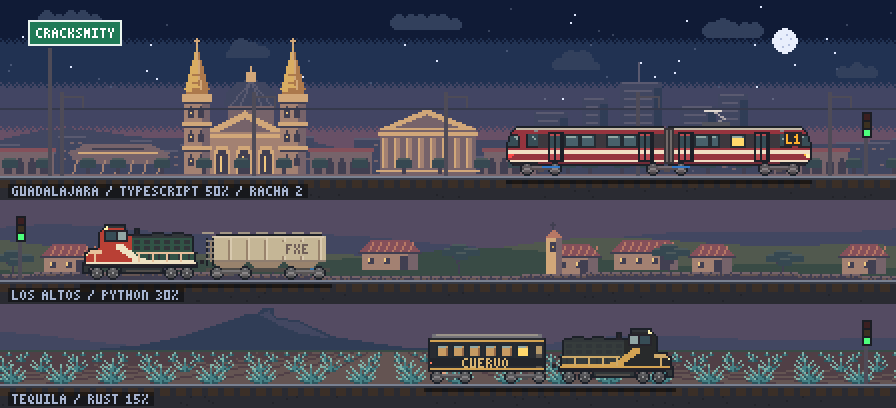
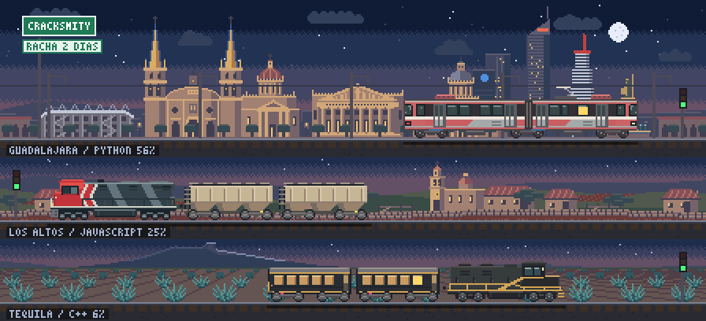

# Jalisco sobre rieles: del primer boceto al README

Esta nota reúne decisiones de diseño y comprobaciones que sirven para crear otra escena regional de git-trains. La escena de Jalisco usa tres vías: el TEG-90 en Guadalajara, el carguero en Los Altos y el José Cuervo Express en el paisaje agavero de Tequila. [Configuración del preset](reference.md#jalisco)

## Antes y después

**Primer boceto.** El TEG-90 llevaba «L1» en la cabina, los vagones tenían letreros («FXE», «CUERVO») y la locomotora del Cuervo se perdía junto al vagón. Guadalajara tenía una cúpula azul al centro de la Catedral y torres genéricas al fondo.

**Escena actual.**
- Las tres vías comparten el mismo cielo nocturno.
- Guadalajara muestra el Estadio Jalisco, la Catedral con el Sagrario, el Teatro Degollado, el Hospicio Cabañas, La Minerva y tres torres del poniente.
- Los Altos tiene tierra colorada, una barda de piedra y una parroquia.
- La racha cuelga en una placa bajo el letrero del perfil.
- Ningún tren lleva letreros.

Las dos imágenes son vistas de prueba. La escena del perfil usa la actividad de GitHub para calcular los porcentajes, la racha y la cantidad de vagones.

## Diseñar y revisar

1. **Parte de una vista lateral.** Anota la forma del frente, la altura de la cabina, la longitud de la locomotora respecto a los vagones y el patrón de ventanas. Si la foto está en perspectiva, úsala para identificar rasgos y busca un perfil para comparar proporciones.
2. **Revisa primero la silueta.** Renderiza el tren en su fondo al ancho del README. En el Cuervo, el ajuste que hizo destacar la locomotora fue pasar de 54 a 76 píxeles de largo frente a los 56 de cada coche. Una sola máquina dejó más espacio visible para los agaves.
3. **Aplica la paleta y revisa el contraste.** Usa las franjas y las ventanillas para distinguir cada tren. Mantén los números de actividad en los rótulos de la escena cuando estorben en la carrocería. En Jalisco, la racha quedó en una placa bajo el nombre del perfil.
4. **Usa los datos de prueba para comparar cambios.** Mantén iguales el tema, el ancho, el encuadre y la cantidad de vagones al comparar dos iteraciones. Revisa después los dos sentidos de marcha, el tema claro y oscuro y el movimiento reducido.

Las reglas generales para pintar fondos a mano están en [Pintar escenarios a mano](development.md#pintar-escenarios-a-mano): dibujar a partir de fotos, apoyar cada parte en la de abajo y usar tintas que solo se ven de noche. Ahí también se explica `npm run zoom`, que genera recortes ampliados de la escena en los dos temas.

## Qué hizo reconocible cada pieza

Cada monumento se ajustó con fotos de referencia, hasta que alguien de Guadalajara lo reconociera a tamaño README.

| Pieza | Lo que la identifica | Lo que se corrigió |
| --- | --- | --- |
| Catedral y Sagrario | Remate curvo con relieve, campanario y óculos, agujas amarillas con aristas azules; el Sagrario de dos pisos con cúpula de teja, pegado a la torre derecha | La cúpula azul del centro no se ve de frente; el Sagrario quedaba separado y su cúpula flotaba |
| Teatro Degollado | Ocho columnas, friso con inscripción, Apolo y las musas en el frontón, alas con balaustrada | Dieciséis columnas lo volvían un templo genérico |
| Hospicio Cabañas | Tambor alto con columnas sobre un cuerpo central, cúpula gris y linternilla | El tambor flotaba sobre el frontón y los remates quedaban sueltos |
| Estadio Jalisco | Techo blanco casi plano con armaduras piramidales pequeñas, concreto aparente y rampas en zigzag | Un arco de armadura grande lo hacía parecer el Bernabéu |
| Torres del poniente | Cuña con antena y letrero rojo; cilindro escalonado con franjas blancas y corona roja; dos prismas de vidrio con un círculo azul | Se descartaron Landmark y el edificio escalonado de Andares: a 15 píxeles parecían torres genéricas |
| TEG-90 | Frente recto, franjas roja y blanca, bogies de tren ligero escondidos tras el faldón | Un contorno casi negro lo hacía ver entintado junto a los otros trenes |
| Carguero de Los Altos | Dos franjas diagonales anchas en el cofre; tolvas sobre trucks de carga como los de la locomotora | Las ruedas grandes del bogie de pasajeros sobresalían del vagón |

Los letreros y logotipos reales se sustituyen por formas y colores, como un letrero rojo o un círculo azul. Así los ejemplos públicos no reproducen marcas.

## Dónde editar

| Objetivo | Archivo o guía |
| --- | --- |
| Crear un tren o fondo personalizado en JSON | Guías de [tren](../ai/train.md), [skyline](../ai/skyline.md) y [campo](../ai/region.md) |
| Asignar un tren distinto a cada vía | [Especificación de escena](../../src/scene/spec.js). Un JSON de tren personalizado se aplica a la primera vía de `multi`. El preset de Jalisco asigna los tres modelos. |
| Ajustar la paleta, la silueta o los vagones de Jalisco | [Modelos](../../src/trains/jalisco.js), [locomotoras](../../src/trains/jalisco-diesels.js) y [vagones](../../src/trains/jalisco-cars.js) |
| Ajustar los fondos de Jalisco | [Composición de Guadalajara](../../src/landscape/jalisco-city.js); [Catedral, Sagrario y Degollado](../../src/landscape/jalisco-centro.js); [Estadio, Cabañas y La Minerva](../../src/landscape/jalisco-landmarks.js); [torres del poniente](../../src/landscape/jalisco-towers.js); [Los Altos y Tequila](../../src/landscape/jalisco-country.js); [paleta](../../src/landscape/jalisco-palette.js) |
| Revisar de cerca | `npm run zoom -- x0 y0 x1 y1`, con `--no-trains` para ver todo el fondo |
| Regenerar las vistas | [Generador de ejemplos](../../scripts/jalisco-examples.js), ejecutado por `npm run docs` |

Desde la raíz del repositorio, `npm run check:docs` comprueba que las vistas guardadas coincidan con sus generadores y verifica los enlaces. `node --test tests/scene/jalisco.test.js` cubre el orden de los trenes, la placa de la racha, el ancho máximo y los dos sentidos.

## Publicar y comprobar el resultado

1. En el workflow del perfil, fija la Action a un commit exacto que incluya la escena. Para Jalisco usa `train: jalisco`, `skyline: jalisco` y `mode: multi` en el bloque `with`.
2. Comprueba el nombre que produce la Action, la rama donde se publica y la URL de la imagen del README. En el perfil de Cracksmity, la escena se publica como `train.svg` en la rama `output`.
3. Cada mejora llega al perfil solo después de fusionarse en `main` y de mover ese commit fijo. Un push al perfil vuelve a correr el workflow.
4. Comprueba el resultado abriendo el SVG por el commit de la rama de salida (`raw.githubusercontent.com/<usuario>/<repo>/<commit>/train.svg`). La URL de la rama queda en caché unos minutos y puede seguir mostrando la versión anterior. Con tres lenguajes aparecen las tres vías; si hay menos, se dibujan las correspondientes.

Al entregar un cambio, registra los archivos editados, las comprobaciones efectuadas y la URL del SVG si se publicó. Para una revisión visual, incluye una captura al ancho del README.
