# Opciones y modelos

[git-trains](../../README.es.md)

## Opciones

| Input | Por defecto | Qué hace |
| --- | --- | --- |
| `train` | `auto` | `auto` evoluciona con tus vagones. Puedes elegir un [modelo](#modelos), los trenes de `jalisco` o la ruta al JSON de [tu propio tren](customization.md#haz-tu-propio-tren-a-mano-o-con-ia). |
| `skyline` | `city` | `city` (generada y única para ti), `new-york`, `osaka`, `jalisco` o la ruta a [tu propio skyline](customization.md#skylines-de-ciudades) en JSON |
| `mode` | `single` | `single`: un tren con tu lenguaje principal · `multi`: 3 vías, un tren por lenguaje, en sentidos opuestos |
| `calendar` | `false` | `true` también escribe el calendario de contribuciones animado (ver arriba) |
| `year-in-review` | `false` | `true` también escribe `year-in-review.svg`: un póster de un año natural, dibujado como un viaje en tren (ver [Resumen del año](usage.md#resumen-del-año)) |
| `review-year` | año en curso | El año que muestra el póster (de 2008 al actual). Vacío: el año en curso hasta hoy, o el año que acaba de terminar en enero |
| `seasons` | `true` | `true` viste la escena con la estación o la fiesta del día en que corre; `false` la deja sin adornos (ver [Estaciones y fiestas](usage.md#estaciones-y-fiestas)) |
| `hemisphere` | `north` | `north` o `south`: qué hemisferio siguen las estaciones. Las fiestas conservan sus fechas |
| `weather` | `off` | Para el skyline `jalisco`: `live` (el clima actual según Open-Meteo), `clear`, `frost`, `heat`, `partly`, `cloudy`, `fog`, `drizzle`, `rain`, `storm`, `hail`, o un estado por lugar separado por comas (ver [Clima](#clima)) |
| `theme` | `both` | `both` escribe `train-light.svg`, `train-dark.svg` y `train.svg` (automático); o `light`, `dark`, `auto`, o `local`: día o noche donde está la escena (ver [Clima](#clima)) |
| `language` | `en` | `en` o `es`: la palabra del letrero (`STREAK` / `RACHA`), el título de la imagen y los textos de las tarjetas |
| `label` | según `language` | Palabra del letrero LED (tiene prioridad sobre `language`) |
| `exclude-languages` | | Lenguajes a dejar fuera, separados por comas, por ejemplo `HTML, Jupyter Notebook` |
| `scale` | `2` | Tamaño de cada píxel (1 a 6) |
| `user` | dueño del repo | Usuario a dibujar |
| `repo` | | `owner/name`: dibuja un repositorio en vez de un usuario (ver [En el README de un repositorio](usage.md#en-el-readme-de-un-repositorio)); `user` se ignora |
| `github-token` | `github.token` | Usa un PAT para contar contribuciones privadas |
| `output-dir` | `dist` | Carpeta de salida |
| `cards` | `none` | Tarjetas de perfil: `stats`, `languages`, `departures` o `both` (estadísticas y lenguajes); también una lista, p. ej. `stats, departures` (ver abajo) |
| `unlocks` | `true` | Añade un vagón especial cuando lo consigues (ver [Vagones desbloqueables](usage.md#vagones-desbloqueables)); `false` se ahorra la petición extra a la API |
| `rank` | `letter` | Centro del anillo de la tarjeta de estadísticas: `letter` (S, A+, B...) o `github` (el logo) |
| `border` | `true` | Borde de las tarjetas |
| `max-languages` | `6` | Lenguajes en la tarjeta de lenguajes (1 a 10) |
| `color-background`, `color-title`, `color-icon`, `color-text`, `color-ring` | GitHub oscuro | Colores de las tarjetas, hexadecimal sin `#` |

El `GITHUB_TOKEN` predeterminado con `contents: read` basta para leer el repositorio actual y los datos públicos; publicar los archivos generados requiere `contents: write`. Un PAT opcional puede revelar contribuciones privadas visibles para su propietario. Guárdalo como secreto de Actions, concede solo el acceso necesario y revisa los SVG antes de publicarlos: las imágenes públicas pueden revelar actividad derivada de contribuciones privadas.

Salidas: `files`, `cars`, `streak`, `state`, `model`.

> ¿Vienes de 0.x? Los nombres en español (`tren`, `fondo`, `modo`, `tema`, `idioma`...) y los ids anteriores (`tranvia`, `metro-blanco`, `bala`...) siguen funcionando y dejan un aviso en el log. Los archivos de salida ahora son `train-*.svg` y `card-*.svg`: actualiza las rutas en tu README. Detalles en el [changelog](../../CHANGELOG.md).
## Modelos

| id | Inspirado en | Alimentación |
| --- | --- | --- |
| `tram` | TEG-90 de SITEUR, Guadalajara: vino con franjas blancas, dos cuerpos articulados sobre un bogie compartido | Catenaria |
| `metro-orange` | NC-82 del Metro de la Ciudad de México: frente facetado y rodadura neumática | Barra guía |
| `metro-gray` | Flota L del Metro de São Paulo (como el L43): acero inoxidable acanalado y máscara negra | Tercer riel |
| `metro-yellow` | A650 renovado de Los Ángeles: frente amarillo con puerta de emergencia al centro | Tercer riel |
| `metro-white` | Alstom Metropolis de la Línea 3 de Guadalajara: banda oscura en las ventanas y cara negra | Catenaria |
| `bullet` | Tren de alta velocidad | Catenaria |

Con `train: auto` el modelo sube conforme ganas vagones: tranvía → metro naranja → metro gris → metro amarillo → metro blanco → tren bala.

Los seis modelos que evolucionan con tu actividad tienen cabinas en ambos extremos. Los trenes con pantógrafo circulan bajo la catenaria.

### Jalisco

Usa `jalisco` tanto en `train` como en `skyline`. En `mode: multi`, los tres primeros lenguajes corresponden al TEG-90 articulado de Guadalajara, al carguero de Los Altos y al José Cuervo Express entre los agaves. La racha cuelga en una placa bajo el letrero con tu nombre. Si hay menos lenguajes, se dibuja el número de vías correspondiente.

[Lecciones de diseño y publicación de la escena de Jalisco](jalisco-lecciones.md)

#### Clima

La escena de Jalisco puede mostrar el clima de sus tres lugares. Agrega `weather` al bloque `with`:

- `live` consulta el clima actual de Guadalajara, Los Altos (en Arandas) y Tequila en [Open-Meteo](https://open-meteo.com/) cuando corre la Action. No necesita clave. Si la consulta falla, la escena se dibuja sin clima y el log explica por qué.
- `clear`, `frost`, `heat`, `partly`, `cloudy`, `fog`, `drizzle`, `rain`, `storm` o `hail` fija el mismo estado en todos los lugares. `storm, rain, cloudy` da un estado por lugar, en el orden de las vías.
- `off`, el valor por defecto, deja la escena como está.

| Estado | Guadalajara | Los Altos | Tequila |
| --- | --- | --- | --- |
| `clear` (despejado) | La escena de siempre | La escena de siempre | La escena de siempre |
| `frost` (helada) | Cielo despejado con escarcha en los árboles de la plaza | Cielo despejado, escarcha blanco azulada en lo alto de las lomas de pasto y los techos de los ranchos, y una línea blanca delgada sobre la cerca de piedra | Cielo despejado con las puntas del agave escarchadas |
| `heat` (calor) | Cielo pálido y cálido de día, bruma más cálida de noche y rayos de sol un píxel más largos | Un tono cálido en lo alto del cielo sobre las lomas | Las laderas lejanas tiemblan en el aire cálido, justo por encima del campo de agave |
| `partly` (medio nublado) | Tres bancos de nubes anchos y planos cruzan el cielo de siempre, con el sol o la luna a la vista en el primer cuadro | Dos bancos pequeños detrás de las lomas y la parroquia | Dos bancos pequeños, uno en parte oculto por el volcán |
| `cloudy` (nublado) | Un techo de nubes con bancos que pasan sobre la ciudad | Un techo y bancos bajos detrás de las lomas | Una bufanda de nubes alrededor del volcán, con la cumbre asomando |
| `fog` (neblina) | El cielo nublado con una franja pálida de neblina tramada sobre la parte baja de la ciudad; las puntas de la Catedral, las torres del poniente y La Minerva sobresalen y la loma del fondo desaparece | Neblina en lo bajo entre las lomas; la torre de la parroquia y las copas de los mezquites sobresalen, y los techos de los ranchos quedan medio visibles | Un banco de neblina sobre las hileras lejanas de agave y las laderas bajas del volcán, con solo la cumbre asomando y las hileras cercanas despejadas |
| `drizzle` (llovizna) | El cielo nublado con gotas finas y escasas, una plaza mojada que refleja los faroles y algunos charcos en el balasto | Gotas finas, tejas que brillan y algunos charcos en el balasto | Gotas finas, la bufanda nublada alrededor del volcán y algunos charcos en el balasto |
| `rain` (lluvia) | Nubes más bajas y oscuras, lluvia, una nube que cruza la torre más alta y una plaza mojada que refleja los faroles | Lluvia, tejas que brillan y agua en los surcos | Lluvia, una bufanda más gruesa y agua en los surcos cercanos |
| `storm` (tormenta) | El cielo más oscuro, lluvia fuerte y relámpagos detrás de las torres de la Catedral | Relámpagos sobre las lomas lejanas | Relámpagos junto al volcán |
| `hail` (granizo) | Bajo los relámpagos, el granizo cae rápido y rebota al tocar el suelo. Se acumula en la plaza, en los techos de la Catedral, del Sagrario y del estadio, y al pie de La Minerva | El granizo se junta en los surcos de tierra roja y en el balasto | Granos blancos entre las hileras de agave y en el balasto |

La imagen se dibuja cuando corre la Action, no cuando alguien abre el README. Para que el clima esté al día, programa el workflow cada pocas horas, por ejemplo `cron: "0 */3 * * *"`. GitHub puede retrasar unos minutos las ejecuciones programadas.

Con `theme: local`, la escena también sigue el día y la noche de Guadalajara:
- La Action escribe un solo `train.svg`: claro mientras el sol está arriba allá y oscuro después del atardecer, según la hora en que corre.
- Calcula la posición del sol con las coordenadas y el reloj, así que no necesita red y funciona aunque no se pueda leer el clima. El log dice qué eligió, por ejemplo `Theme local: the sun is 44° above the horizon in Guadalajara -> light`.
- Para que cambie cerca del amanecer y el atardecer, programa el workflow cada hora (`cron: "0 * * * *"`).
- Los skylines sin lugares reales usan `auto`, que sigue el modo claro u oscuro de quien ve el README.

Open-Meteo reporta códigos de clima WMO. El código 0 corresponde a `clear` y los códigos 1 y 2 a `partly`. Con cualquiera de los tres, una temperatura de 2 °C o menos da `frost` y una de 32 °C o más da `heat`. El código 3 corresponde a `cloudy`, y el 45 y el 48 a `fog`. El código 95 corresponde a `storm`, y el 96 y el 99 a `hail`. La nieve cuenta como `rain`. El arte de esos y otros climas está en la [lista de climas pendientes](clima-pendiente.md), con prompts listos para usar. El título de la imagen nombra el clima de cada lugar para los lectores de pantalla. Datos del clima de [Open-Meteo](https://open-meteo.com/), con licencia CC BY 4.0.

En Jalisco el clima reemplaza la nieve, los pétalos y las hojas de cada estación; las fiestas se quedan. Los demás skylines conservan sus estaciones. Para cambiar esa regla, edita la lista `WEATHER_OVER_SEASONS` en [src/scene/weather.js](../../src/scene/weather.js).
