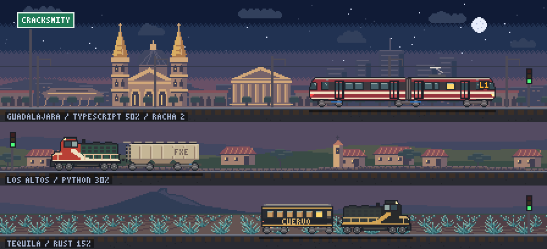
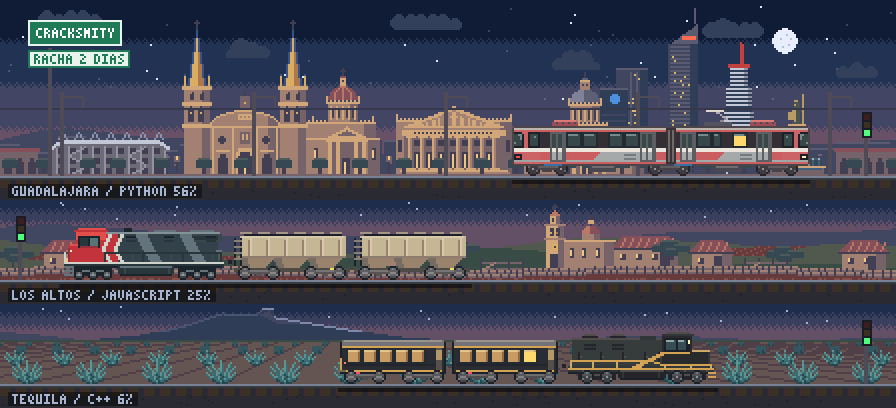

# Jalisco on the rails: from the first sketch to the README

These notes collect design decisions and checks that help when creating another regional scene for git-trains. The Jalisco scene has three tracks: the TEG-90 in Guadalajara, the freight train in Los Altos and the José Cuervo Express among the agave fields of Tequila. [Preset settings](reference.md#jalisco)

## Before and after

**First sketch.** The TEG-90 carried "L1" on its cab, the cars had lettering ("FXE", "CUERVO") and the Cuervo locomotive was lost beside its coach. Guadalajara had a blue dome in the middle of the Cathedral and generic towers in the background.

**Current scene.**
- All three tracks share the same night sky.
- Guadalajara shows Estadio Jalisco, the Cathedral with the Sagrario, Teatro Degollado, Hospicio Cabañas, La Minerva and three west-side towers.
- Los Altos has red earth, a dry-stone wall and a parish church.
- The streak hangs on a plaque below the profile sign.
- No train carries lettering.

Both images are previews. The profile scene uses GitHub activity to compute the percentages, the streak and the number of cars.

## Design and review

1. **Start from a side view.** Note the shape of the front, the cab height, the locomotive's length compared with the cars, and the window pattern. If the photo is in perspective, use it to identify features and find a profile to compare proportions.
2. **Check the silhouette first.** Render the train on its backdrop at README width. For the Cuervo, what made the locomotive stand out was growing it from 54 to 76 pixels, against 56 for each coach. A single locomotive left more of the agave visible.
3. **Apply the palette and check the contrast.** Use stripes and windows to tell each train apart. Keep activity numbers in the scene's captions when they would crowd the body. In Jalisco, the streak moved to a plaque below the profile name.
4. **Compare changes with the sample data.** Keep the theme, width, framing and number of cars the same when comparing two iterations. Then check both directions of travel, the light and dark themes, and reduced motion.

The general rules for hand-painted backdrops are in [Painting scenery by hand](development.md#painting-scenery-by-hand): draw from photos, rest every part on the one below, and use inks that only show at night. That section also explains `npm run zoom`, which writes enlarged crops of the scene in both themes.

## What made each piece recognizable

Each landmark was adjusted against reference photos until someone from Guadalajara recognized it at README size.

| Piece | What identifies it | What was fixed |
| --- | --- | --- |
| Cathedral and Sagrario | Curved gable with its relief, bell and oval-window stages, yellow spires with blue ribs; the two-storey Sagrario with a tiled dome, joined to the right tower | The central blue dome is not visible from the front; the Sagrario stood apart and its dome floated |
| Teatro Degollado | Eight columns, the inscribed frieze, Apollo and the muses in the pediment, balustraded wings | Sixteen columns turned it into a generic temple |
| Hospicio Cabañas | Tall colonnaded drum on a central block, grey dome and lantern | The drum floated above the pediment and the finials hung loose |
| Estadio Jalisco | Almost flat white roof with small pyramidal trusses, exposed concrete and zigzag ramps | A large arched truss made it look like the Bernabéu |
| West-side towers | A wedge with a mast and a red sign; a stepped cylinder with white bands and a red crown; two glass prisms with a blue disc | Landmark and the stepped building in Andares were dropped: at 15 pixels they looked like generic towers |
| TEG-90 | Upright front, red and white bands, light-rail bogies tucked behind the skirt | A near-black outline made it look inked beside the other trains |
| Los Altos freight | Two broad diagonal bands on the hood; hoppers on freight trucks like the locomotive's | The large passenger-bogie wheels stuck out of the cars |

Real signs and logos are replaced with shapes and colors, such as a red sign or a blue disc. This keeps brand marks out of the public examples.

## Where to edit

| Goal | File or guide |
| --- | --- |
| Create a custom train or backdrop in JSON | Guides for the [train](ai/train.md), [skyline](ai/skyline.md) and [countryside](ai/region.md) |
| Give each track a different train | [Scene specification](../src/scene/spec.js). A custom train JSON applies to the first track in `multi`. The Jalisco preset assigns all three models. |
| Adjust the Jalisco palette, silhouettes or cars | [Models](../src/trains/jalisco.js), [locomotives](../src/trains/jalisco-diesels.js) and [cars](../src/trains/jalisco-cars.js) |
| Adjust the Jalisco backdrops | [Guadalajara composition](../src/landscape/jalisco-city.js); [Cathedral, Sagrario and Degollado](../src/landscape/jalisco-centro.js); [Stadium, Cabañas and La Minerva](../src/landscape/jalisco-landmarks.js); [west-side towers](../src/landscape/jalisco-towers.js); [Los Altos and Tequila](../src/landscape/jalisco-country.js); [palette](../src/landscape/jalisco-palette.js) |
| Review up close | `npm run zoom -- x0 y0 x1 y1`, with `--no-trains` to see the whole backdrop |
| Regenerate the previews | [Example generator](../scripts/jalisco-examples.js), run by `npm run docs` |

From the repository root, `npm run check:docs` checks that the saved previews match their generators and verifies the links. `node --test tests/scene/jalisco.test.js` covers the order of the trains, the streak plaque, the maximum width and both directions.

## Publish and check the result

1. In the profile workflow, pin the Action to an exact commit that includes the scene. For Jalisco, use `train: jalisco`, `skyline: jalisco` and `mode: multi` in the `with` block.
2. Check the file name the Action writes, the branch it publishes to and the image URL in the README. On the Cracksmity profile, the scene is published as `train.svg` on the `output` branch.
3. Each improvement reaches the profile only after it is merged into `main` and that pinned commit moves. A push to the profile runs the workflow again.
4. Check the result by opening the SVG at the output branch's commit (`raw.githubusercontent.com/<user>/<repo>/<commit>/train.svg`). The branch URL stays cached for a few minutes and can still show the previous version. With three languages all three tracks appear; with fewer, the scene draws that many.

When handing over a change, record the edited files, the checks that ran and the SVG URL if it was published. For a visual review, include a screenshot at README width.
