# Inputs and models

[git-trains](../README.md)

## Options

| Input | Default | What it does |
| --- | --- | --- |
| `train` | `auto` | `auto` evolves with your cars. Choose a [model](#models), the `jalisco` fleet, or a [custom train](customization.md#make-your-own-train-by-hand-or-with-ai) JSON path. |
| `skyline` | `city` | `city` (procedural, unique to you), `new-york`, `osaka`, `jalisco`, `jalisco-sayula` or the path to [your own skyline](customization.md#city-skylines) in JSON |
| `mode` | `single` | `single`: one train in your top language · `multi`: 3 tracks, one train per language, running opposite ways |
| `calendar` | `false` | `true` also writes the animated contribution calendar (see above) |
| `year-in-review` | `false` | `true` also writes `year-in-review.svg`: a poster of one calendar year, drawn as a train journey (see [Year in review](usage.md#year-in-review)) |
| `review-year` | current year | The year the poster shows (2008 to the current one). Empty: the current year so far, or the year that just ended in January |
| `seasons` | `true` | `true` dresses the scene for the season or holiday of the day it runs; `false` keeps it plain (see [Seasons and holidays](usage.md#seasons-and-holidays)) |
| `hemisphere` | `north` | `north` or `south`: which hemisphere the seasons follow. Holidays keep their dates |
| `weather` | `off` | For `jalisco` and `jalisco-sayula`: `live` (the current weather from Open-Meteo), `clear`, `frost`, `heat`, `partly`, `cloudy`, `fog`, `drizzle`, `rain`, `snow`, `storm`, `hail`, or one state per place separated by commas (see [Weather](#weather)) |
| `weather-cache` | | With `weather: live`: the path of a `.json` file in the repository that keeps the last good reading between runs, for when Open-Meteo can't be reached (see [Keep the last reading](#keep-the-last-reading)) |
| `theme` | `both` | `both` writes `train-light.svg`, `train-dark.svg` and `train.svg` (automatic); or `light`, `dark`, `auto`, or `local`: day or night where the scene is (see [Weather](#weather)) |
| `language` | `en` | `en` or `es`: the word on the sign (`STREAK` / `RACHA`), the image title and the card texts |
| `label` | from `language` | Word on the LED sign (overrides `language`) |
| `exclude-languages` | | Comma-separated languages to leave out, e.g. `HTML, Jupyter Notebook` |
| `unlocks` | `true` | Add a special car when you earn it (see [Unlockable cars](usage.md#unlockable-cars)); `false` skips the extra API request |
| `scale` | `2` | Size of each pixel (1 to 6) |
| `user` | repo owner | User to draw |
| `repo` | | `owner/name`: draw a repository instead of a user (see [In a repository README](usage.md#in-a-repository-readme)); `user` is then ignored |
| `github-token` | `github.token` | Use a PAT to count private contributions |
| `output-dir` | `dist` | Output folder |
| `cards` | `none` | Profile cards: `stats`, `languages`, `departures` or `both` (stats and languages); a list works too, e.g. `stats, departures` (see below) |
| `rank` | `letter` | Center of the stats card ring: `letter` (S, A+, B...) or `github` (the logo) |
| `border` | `true` | Card border |
| `max-languages` | `6` | Languages on the languages card (1 to 10) |
| `color-background`, `color-title`, `color-icon`, `color-text`, `color-ring` | GitHub dark | Card colors, hex without `#` |

The default `GITHUB_TOKEN` with `contents: read` is sufficient for reading the current repository and public data; publishing generated files requires `contents: write`. An optional PAT may expose private contributions visible to its owner. Store it as an Actions secret, grant only the access required, and review the generated SVGs before publishing: public images can reveal activity derived from private contributions.

Outputs: `files`, `cars`, `streak`, `state`, `model`.

> Coming from 0.x? The Spanish input names (`tren`, `fondo`, `modo`, `tema`, `idioma`...) and model ids (`tranvia`, `metro-blanco`, `bala`...) still work and log a deprecation warning. The output files are now `train-*.svg` and `card-*.svg`: update the paths in your README. See the [changelog](../CHANGELOG.md).
## Models

| id | Inspired by | Power |
| --- | --- | --- |
| `tram` | SITEUR TEG-90, Guadalajara: wine red with white stripes, two articulated bodies on a shared bogie | Overhead wire |
| `metro-orange` | Mexico City Metro NC-82: faceted front and rubber tyres | Guide bar |
| `metro-gray` | São Paulo Metro L fleet (like the L43): fluted stainless steel and a black mask | Third rail |
| `metro-yellow` | Refurbished Los Angeles A650: yellow front with an emergency door in the middle | Third rail |
| `metro-white` | Alstom Metropolis of Guadalajara Line 3: dark window band and black face | Overhead wire |
| `bullet` | High-speed train | Overhead wire |

With `train: auto` the model moves up as you gain cars: tram → orange metro → gray metro → yellow metro → white metro → bullet train.

The six evolving models have cabs at both ends. Trains with a pantograph run under overhead wires.



### Jalisco

Set both `train` and `skyline` to `jalisco`. In `mode: multi`, the first three languages get Guadalajara's articulated TEG-90, a freight train in Los Altos, and the José Cuervo Express in the agave fields. The streak hangs on a plaque below your name sign. With fewer languages, the scene uses the corresponding number of tracks.

Set `skyline: jalisco-sayula` to take the freight train past the Laguna de Sayula between Guadalajara and Tequila. With `weather: live`, the middle caption shows the temperature in Sayula.



[Design and publishing notes from the Jalisco scene](jalisco-notes.md)

#### Weather

The Jalisco scene can wear the weather of its three places. Add `weather` to the `with` block:

- `live` reads the current weather in Guadalajara, Los Altos (at Arandas) and Tequila from [Open-Meteo](https://open-meteo.com/) when the Action runs and shows each place's temperature in its caption (for example `Tequila 20° / Rust 15%`). It needs no key. If the reading fails, the scene is drawn without weather and the log says why.
- `clear`, `frost`, `heat`, `partly`, `cloudy`, `fog`, `drizzle`, `rain`, `snow`, `storm` or `hail` fixes one state for every place without temperatures in the captions. `storm, rain, cloudy` gives one state per place, in track order.
- Append `+wind` to any state. `rain+wind` brings wind to all three places, while `storm+wind, clear, hail+wind` leaves Los Altos calm. Live weather adds wind wherever the speed reaches 40 km/h. Trees sway, red dust blows off the plowed fields in Los Altos, and rain and hail fall diagonally.
- Append `+haze` for a brown layer over Guadalajara’s distant ridge and west-side towers. It appears with `clear`, `partly`, `cloudy`, `heat` and `fog`, and combines with wind in either order, as in `cloudy+wind+haze`. The Cathedral and the landmarks in front stay sharp.
- In `live` mode a second, optional request reads PM2.5 from Open-Meteo’s air-quality API for Guadalajara alone. Haze appears in those states above 55 µg/m³. If this reading fails, the Action logs a notice and draws the weather it received.
- `off`, the default, leaves the scene as it is.

##### Keep the last reading

GitHub's runners share IP addresses, and Open-Meteo counts its free daily quota per address. So a live reading can fail through no fault of yours: a timeout, or a `429` once the shared address has spent its quota. Set `weather-cache` to a `.json` path and keep that file between runs with `actions/cache`:
- After each good reading, the Action saves it there.
- When Open-Meteo can't be reached, the scene wears the saved reading if it is at most 6 hours old, and the log says how old it is.
- A reading saved for other places, such as Los Altos after you switch to `jalisco-sayula`, is not used.

```yaml
      - uses: actions/cache/restore@55cc8345863c7cc4c66a329aec7e433d2d1c52a9 # v6.1.0
        with:
          path: .weather/last.json
          key: weather-${{ github.run_id }}
          restore-keys: weather-
      # Your git-trains step, with these two inputs in its `with` block:
      #   weather: live
      #   weather-cache: .weather/last.json
      - uses: actions/cache/save@55cc8345863c7cc4c66a329aec7e433d2d1c52a9 # v6.1.0
        if: always()
        with:
          path: .weather/last.json
          key: weather-${{ github.run_id }}
```

Each run saves under a key of its own, and `restore-keys` brings back the newest one. The file holds only the weather at the scene's public places. Keep it outside `output-dir` so it isn't published with the images.

| State | Guadalajara | Los Altos | Tequila |
| --- | --- | --- | --- |
| `clear` | The usual scene | The usual scene | The usual scene |
| `frost` | Clear sky with frost on the plaza trees | Clear sky, pale blue-white frost along the pasture and grassland ridges and ranch roofs, and a thin white line on the dry-stone wall | Clear sky with frosted agave tips |
| `heat` | Pale warm sky by day, warmer haze at night, and sun rays one pixel longer | Warm upper sky above the hills | The distant slopes shimmer just above the agave field under the warm sky |
| `partly` (partly cloudy) | Three broad, flat cloud banks drift across the usual sky, with the sun or moon visible in the opening frame | Two small banks behind the hills and church | Two small banks, one partly hidden by the volcano |
| `cloudy` | A cloud ceiling with banks drifting over the city | A ceiling and low banks behind the hills | A scarf of cloud around the volcano, with the summit above it |
| `fog` | The cloudy sky with a dithered pale fog band over the lower city; the Cathedral spires, west-side towers and La Minerva rise out of it and the distant ridge disappears | Fog in the low ground between the hills; the parish church tower and mesquite crowns rise above it, and the ranch roofs stay half visible | A fog bank over the far agave rows and lower volcano slopes, with only the summit above it and the nearer rows clear |
| `drizzle` | The cloudy sky with fine, sparse drops, a wet plaza reflecting the lamps and a few puddles on the ballast | Fine drops, shining tile roofs and a few puddles on the ballast | Fine drops, the cloudy scarf around the volcano and a few puddles on the ballast |
| `rain` | Lower, darker clouds, rain, a wisp across the tallest tower and a wet plaza that reflects the lamps | Rain, shining tile roofs and water in the furrows | Rain, a thicker scarf and water in the nearer furrows |
| `snow` | The cloudy sky with slow drifting flakes; snow rests on the Cathedral's spires and roofs, the stadium roof, historic domes, plaza trees and the plaza row | Drifting flakes, white on the ranch and parish church roofs and along the top of the dry-stone wall, with snow patches over the hills so the red parcels show through | Drifting flakes, white upper slopes on the Volcán de Tequila and a touch of snow on the agave tips |
| `storm` | The darkest sky, heavy rain and lightning behind the Cathedral's spires | Lightning over the far hills | Lightning beside the volcano |
| `hail` | Lightning above fast white pellets that bounce at ground level. Hail piles up in the plaza, on the Cathedral, Sagrario and stadium roofs, and at the foot of La Minerva | Hail gathers in the red-earth furrows and on the ballast | White pellets collect between agave rows and on the ballast |



The image is drawn when the Action runs, not when someone opens the README. To keep the weather current, schedule the workflow every few hours, for example `cron: "0 */3 * * *"`. GitHub can delay scheduled runs by a few minutes.

With `theme: local`, the scene also follows day and night in Guadalajara:
- The Action writes a single `train.svg`: light while the sun is up there and dark after sunset, as it stands when the Action runs.
- It computes the sun's position from the coordinates and the clock, so it needs no network and works even when the weather can't be read. The log says what it chose, such as `Theme local: the sun is 44° above the horizon in Guadalajara -> light`.
- To switch close to sunrise and sunset, run the workflow every hour (`cron: "0 * * * *"`).
- Skylines without real places fall back to `auto`, which follows the viewer's light or dark mode.

Open-Meteo reports WMO weather codes. Code 0 gives `clear` and codes 1 and 2 give `partly`. For all three codes, temperatures of 2 °C or below give `frost`, and temperatures of 32 °C or above give `heat`. Code 3 gives `cloudy`, and codes 45 and 48 give `fog`. Codes 51 to 57 give `drizzle`, codes 61 to 67 and 80 to 82 give `rain`, and codes 71, 73, 75, 77, 85 and 86 give `snow`. Code 95 gives `storm`, and codes 96 and 99 give `hail`. The rules a new weather design follows are in the [weather backlog](weather-backlog.md). The image title names each place's weather for screen readers. Weather and air-quality data by [Open-Meteo](https://open-meteo.com/), licensed CC BY 4.0.

Idea by Estrellita ✨: showing the real weather of Guadalajara, Los Altos and Tequila in the scene.

In Jalisco the weather replaces the seasonal snow, blossom and leaves; holidays stay. Other skylines keep their seasons. To change that rule, edit the `WEATHER_OVER_SEASONS` list in [src/scene/weather.js](../src/scene/weather.js).
